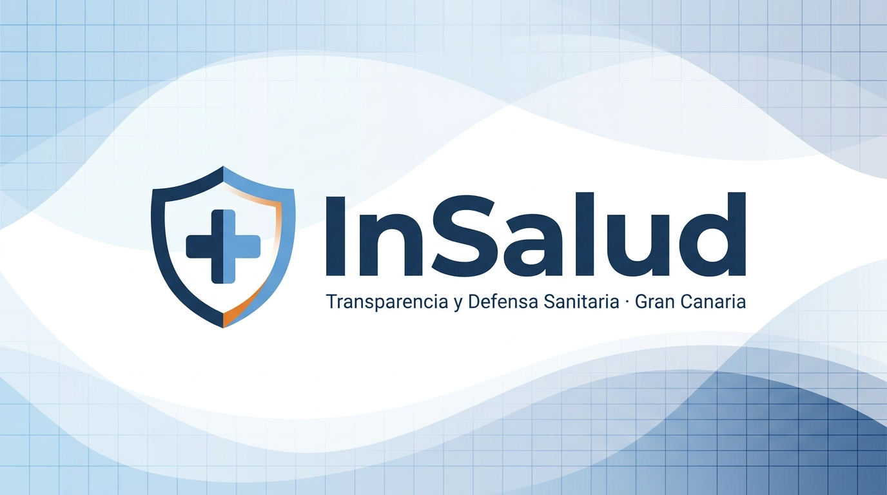

# InSalud — Plataforma Ciudadana de Defensa Sanitaria (Gran Canaria)

Plataforma **Civic Tech** orientada a visibilizar incidencias en el Servicio Canario de la Salud (SCS) en Gran Canaria y guiar al paciente hacia una **reclamación formal efectiva** bajo el **Decreto 8/2025** y la **Ley 39/2015**, sin recopilar nunca datos de identidad oficial.

**Demo en producción:** [https://insalud-gc.vercel.app](https://insalud-gc.vercel.app)

---

## Características Principales

- **Denuncia Anónima y Evidencia Colectiva:** Formulario web y listado público filtrable por centro de salud u hospital (`public_complaints`), con adjuntos privados en Supabase Storage y panel de moderación (`admin/index.html`).
- **Pipeline de Defensa del Paciente:**
  - **Medidas Concretas Solicitadas:** Permite exigir acciones específicas (respuesta motivada punto por punto, expediente informativo, cita urgente, cambio de facultativo) evitando respuestas genéricas.
  - **Motor de Enrutamiento Institucional (`js/routing-engine.js`):** Clasifica el caso y redirige según corresponda a:
    - **SCS / ODDUS — Reclamación Sanitaria (`Trámite 1768`)**: Plazo máximo legal de 2 meses.
    - **ODDUS — Escrito de Disconformidad (`Trámite 6465`)**: Para respuestas vacías o silencio tras 2 meses.
    - **SCS — Responsabilidad Patrimonial (`Trámite 1817`)**: Daños o secuelas asistenciales.
    - **Asociación El Defensor del Paciente**: Valoración jurídica en negligencias, diagnósticos tardíos o listas de espera graves.
    - **Diputado del Común**: Defensor del Pueblo en Canarias.
  - **Redirección Zero-PII:** El escrito formal se genera y se copia/descarga localmente en el navegador. **InSalud nunca recopila DNI, certificados digitales ni credenciales Cl@ve**; la firma se realiza directamente en la Sede Electrónica oficial.
- **Seguimiento de Plazos (60 días):** Edge Function `deadline-reminder` (protegida con `CRON_SECRET` y con bloqueo de seguridad `dry-run-no-domain` si no hay dominio de proyecto verificado en `REMINDER_FROM_EMAIL`).

---

## Arquitectura y Estructura

```text
├── index.html                  # Formulario ciudadano + flujo de tramitación oficial
├── listado.html                # Listado público de reclamaciones aprobadas
├── css/styles.css              # Estilos mobile-first
├── js/
│   ├── app.js                  # Validación, subida de adjuntos y borrador formal local
│   ├── routing-engine.js       # Motor puro de enrutamiento institucional (Gran Canaria)
│   ├── listado.js              # Paginación y filtros del listado público
│   ├── supabase-client.js      # Cliente Supabase (anon key + RLS)
│   └── data/centros.js         # Catálogo de hospitales y centros de salud de Gran Canaria
├── supabase/
│   ├── migrations/             # Esquema SQL, RLS, vista security_barrier y tracking 60d
│   └── functions/
│       ├── telegram-webhook/   # Bot de Telegram (Deno)
│       └── deadline-reminder/  # Recordatorio automático de plazo de 2 meses
└── tests/                      # Suite de tests unitarios en Node.js
```

---

## Desarrollo Local y Tests

### Levantar en local
```bash
python3 -m http.server 8888
```
Abrir `http://localhost:8888/index.html`.

### Ejecutar tests unitarios
```bash
node tests/form.test.cjs
node tests/routing.test.cjs
node tests/listado.test.cjs
node tests/admin.test.cjs
node tests/backend-webhook.test.cjs
```

---

## Seguridad y Privacidad

- **Row Level Security (RLS)** estricto en PostgreSQL (`complaints`, `attachments`, `profiles`).
- Vista `public_complaints` con `security_barrier = true` que excluye `email` y metadatos internos.
- Función RPC `submit_complaint` con `SECURITY DEFINER` y validación en servidor.
- Bucket privado `complaint-attachments` accesible solo mediante URLs firmadas temporales (60s) para administradores.
- Los campos opcionales de nombre y DNI para el borrador descargable se procesan exclusivamente en memoria del navegador y no se envían a Supabase.

---

## Despliegue Propio (Fork / Open Source)

1. Crea un proyecto gratuito en [Supabase](https://supabase.com) y ejecuta en el **SQL Editor**, en este orden, las migraciones de `supabase/migrations/`:
   1. `001_initial_schema.sql`
   2. `002_fix_permissions.sql`
   3. `003_security.sql`
   4. `004_pipeline_tracking.sql`
2. Actualiza `SUPABASE_URL` y `SUPABASE_ANON_KEY` en `js/supabase-client.js` con las claves públicas de tu proyecto.
3. Despliega el frontend estático en Vercel, Cloudflare Pages o GitHub Pages (sin paso de compilación).
4. *(Opcional)* Despliega `supabase/functions/deadline-reminder` configurando `CRON_SECRET`, `RESEND_API_KEY` y `REMINDER_FROM_EMAIL` en los secretos de Edge Functions.

## Licencia

Distribuido bajo licencia [MIT](LICENSE).
